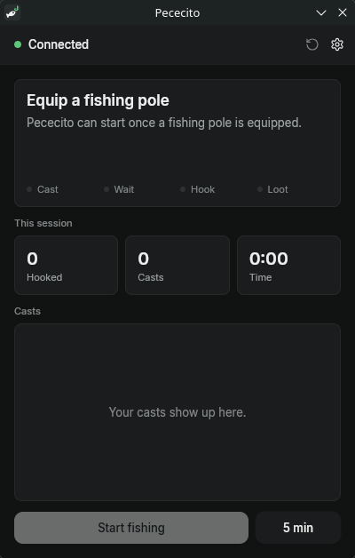

# Pececito

Fishing bot for WoW Forever. It casts, listens for the splash, and hooks.

<p align="center"></p>

Works on Linux. Windows builds run but don't fish yet. No macOS build yet.

## Install

Linux:

```sh
curl -fsSL https://raw.githubusercontent.com/acidtib/pececito/main/script/install.sh | sh
```

Windows: grab `Pececito-x86_64.exe` from the [latest release](https://github.com/acidtib/pececito/releases/latest).

On a Wayland desktop, Pececito runs through XWayland, the same way the game does, so the window
reopens where you left it. Without XWayland it runs on Wayland, and your desktop picks where the
window opens each time. If you use fractional scaling, XWayland can draw the window slightly
blurry, depending on your desktop's XWayland scaling setting.

## Fish

1. Bind a key to fishing, turn on auto loot, keep sound effects on.
2. Install the addon from the app, then `/reload` in game.
3. Stand at the water with your pole equipped.
4. Press Start fishing and click the game window.

## Develop

```sh
cargo run
cargo clippy --workspace --all-targets
cargo test --workspace
```
